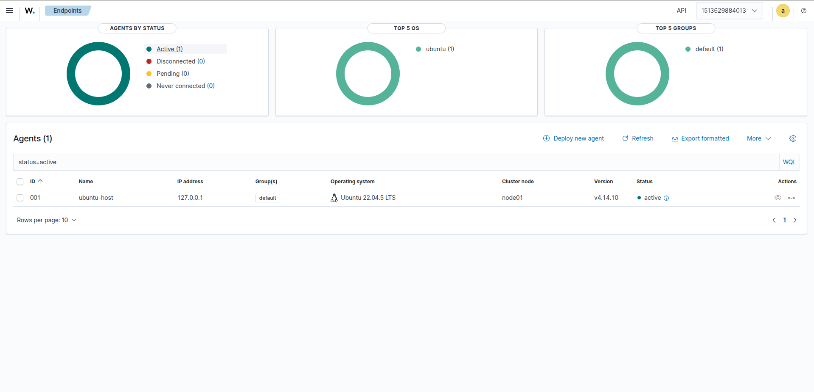
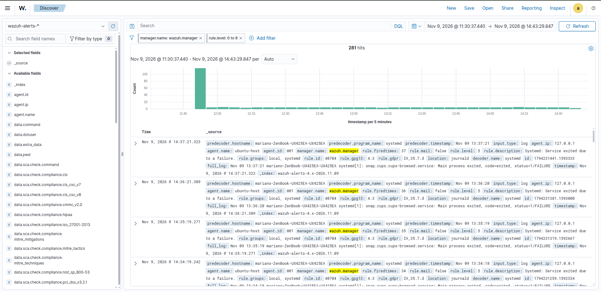
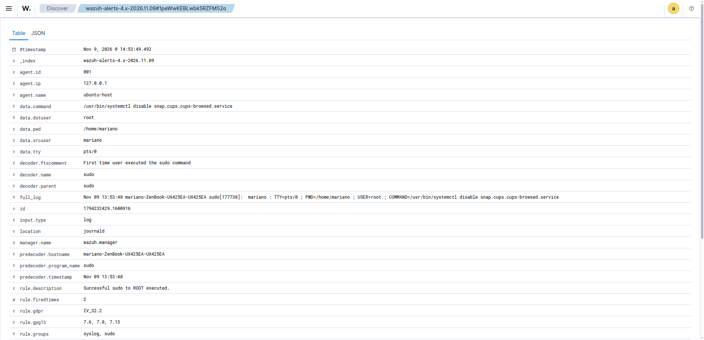
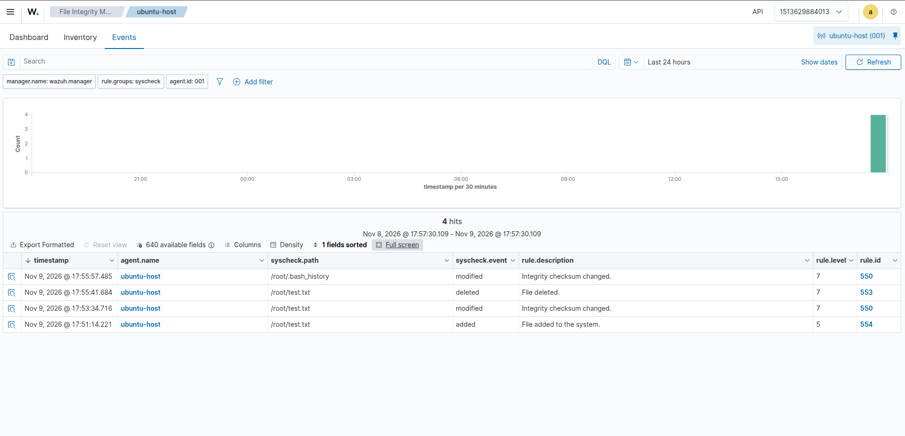

# PHASE 1 
(All the answers are written in Spanish)


## What does Wazuh do, and how does an event travel from the agent to the dashboard?

Wazuh es un sistema de seguridad gratuito, de código abierto, que funciona como un vigilante o guardia de seguridad para los dispositivos de una empresa. 

Su arquitectura consta de uno o varios agentes y 3 grandes componentes centrales: el servidor, el indexador y el dashboard. La forma en que se comunican entre sí y el camino que seguiría un evento desde que se recoge en el agente hasta que se muestra en el dashboard sería el siguiente:

1. El agente se instala en cada uno de los dispositivos y se encarga de recoger información de seguridad (eventos) que envía al servidor. Para ello, los agentes establecen una conexión cifrada con el servidor.
2. El servidor recibe los eventos, decodifica los datos y los contrasta con un motor de reglas para interpretar la información. Posteriormente se envían al indexador, que los almacena.
3. El dashboard se comunica con el servidor para mostrar la información del usuario y sus agentes y con el indexador para obtener los datos de seguridad guardados. Es aquí donde el evento llega finalmente a mostrarse en el dashboard al usuario.


---
## What did you try in your lab, and what did you learn from it?

#### Despliegue y decisiones previas de aquitectura

- Decidí instalar los componentes centrales de Wazuh (Manager, Indexer y Dashboard) en Docker. De esta forma quedaban aislados los servicios más pesados sin ensuciar mi sistema base con dependencias y datos locales.

- El agente lo instalé directamente en mi máquina con ubuntu, para poder tener acceso a las llamadas del sistema y monitorizar datos reales como se puede ver en los ejemplos de más adelante.


*Configuración del agente en el dashboard.*

#### Caso 1: Detección y resolución de una anomalía real del sistema

Tras la instalación de Wazuh y estar un rato explorando el Dashboard, me di cuenta de que el contador de alertas "low severity" no paraba de subir de forma periódica. Al filtrarlas, vi que todas eran idénticas y procedían de la regla 40704 de `systemd` (nivel 5), capturadas por el agente a través de `journald`.

Analizando el `full_log` del evento, identifiqué el error exacto:

```
snap.cups.cups-browsed.service: Main process exited, code=exited, status=1/FAILURE
```


*Alertas generada por la regla 40704 de systemd al fallar repetidamente el proceso snap.cups.cups-browsed.*

Al investigar qué hacía ese servicio, comprobé que `cups-browsed` se encarga del descubrimiento automático de impresoras en red local. Al estar en un bucle continuo de fallos y reinicios, solo consumía CPU inútilmente y ensuciaba los logs. Decidí detenerlo y deshabilitarlo con `systemctl`.

Para ello, ejecuté los siguientes comandos:

```
sudo systemctl stop snap.cups.cups-browsed.service

sudo systemctl disable snap.cups.cups-browsed.service 
```


Al volver al Dashboard, pude verificar dos cosas: que el flujo constante de alertas periódicas se detuvo por completo y que Wazuh registró una nueva alerta confirmando el cambio de estado del servicio en el host.


*Alerta de deshabilitación del servicio en el Dashboard.*

##### Conclusión: 

Este caso, me ha permitido detectar una anomalía real de mi sistema analizando las alertas de Wazuh. La primera impresión que me llevo es muy positiva: casi sin saber usarlo ya me ha servido para solucionar un problema que tenía en segundo plano, así que cuando aprenda a manejarlo mejor, tiene pinta de que va a ser muy potente.

Gracias a ello he aprendido como el agente es capaz de leer directamente del systemd-journald sin necesidad de configurar nada de forma compleja. He observado como las reglas tienen asignadas números y se clasifican según el nivel de severidad. Además las reglas repetidas se agrupan bajo el campo `firedtimes`, lo cual permite saber el número de veces que ha aparecido una misma regla. Por otro lado, he aprendido que el Dashboard, en concreto la parte de alertas, no solo sirve para detectar incidencias, si no también para verificar que una acción realizada en el sistema ha tenido éxito.

#### Caso 2: Prueba de integridad de archivos (FIM):

Para ver más casos de uso, busqué más información en la documentación oficial de Wazuh. En el apartado "Proof of Concept guide" se explican ejemplos muy interesantes y didácticos. Decidí probar el de "File integrity monitoring".

En primer lugar, edité el documento de configuración `/var/ossec/etc/ossec.conf`, de forma que Wazuh fuese capaz de monitorizar en tiempo real el directorio `/root` añadiendo la siguiente línea:

```
<directories check_all="yes" report_changes="yes" realtime="yes">/root</directories>
```

Después, reinicié el agente para aplicar las configuraciones mediante el comando:

```
sudo systemctl restart wazuh-agent
```

Una vez, apareció el log en el archivo `/var/ossec/logs/ossec.log` indicando que comenzaba la monitorización en tiempo real, ya estaba todo listo para realizar cambios en el directorio `/root` .

Se creó un archivo llamado test.txt. Se modificó su contenido, añadiendo una línea de prueba y guardándolo. Y se eliminó el archivo. En la siguiente imagen se pueden observar los tres primeros eventos que hacen relación a ellos. 

Además se observa un cuarto y último evento, que justo se registró al cerrar la sesión como usuario root desde la terminal. Debido a que el archivo de registro de comandos `/root/.bash_history` fue modificado y wazuh seguía vigilando el directorio, también quedó grabado.



*Eventos de prueba de integridad de archivos en el directorio /root .*

##### Conclusión: 

He podido comprobar de primera mano como Wazuh, además de la opcíon de detección periódica, también es capaz de monitorizar archivos en tiempo real. Esto es esencial para detectar cualquier actividad sospechosa o intrusión en carpetas sensibles siempre que sea necesario.

---
## What was hard, and how did you get past it?

Sinceramente, la elección del método de instalación a seguir ya supuso un pequeño reto. Al tener tanta documentación y diferentes formas de instalar wazuh, no sabía cual sería la más correcta para este laboratorio. Al principio dudaba entre usar la instalación rápida o la instalación de cada uno de los módulos por separado. Pero después encontré la opción de instalar con Docker y tras refrescar un poco la memoria porque hacía tiempo que no lo usaba, se instaló en un momento. Me parece que es la más adecuada porque permite tenerlo todo en un entorno aislado, iniciarlo y pararlo cuando quieras y es rápido, por lo que he podido dedicarle más tiempo a probar Wazuh.

Posteriormente, tras llevar un rato moviéndome por la interfaz, me quedé un poco en blanco porque no sabía bien cómo seguir. Entonces se me ocurrió analizar por qué había tantas alertas. Me costó aprender a interpretar toda la información de los eventos que aparecían y ver cual era realmente el problema. Al ver que se repetían los mismo eventos ya empecé a investigar en internet acerca de la alerta de "cups-browsed" y leí que era conveniente desactivarlo.

Por lo demás, lo más difícil ha sido acostumbrarse a la interfaz, a la arquitectura de Wazuh, interpretar toda la cantidad de datos que aparecen... Y tras un día bien completo de pruebas y leer documentación pienso que he aprendido información muy interesante.

---
## If you had one more day with your lab, what would you explore next, and why?


1. Escalar el montaje añadiendo un segundo agente. Montaría una VM o conectaría otro equipo de mi red local para ver como se gestiona el Dashboard con más de una fuente de datos.
2. Explorar más casos de uso de los que aparecen en la documentación, como por ejemplo el de inyección de SQL o bloquear a un actor malicioso conocido. Para ellos se necesita usar un endpoint extra para hacer de atacante/víctima.
3. Analizar con más detalle las vulnerabilidades que Wazuh ha detectado en mi endpoint de ubuntu, para ver si alguna necesita atención extra.


