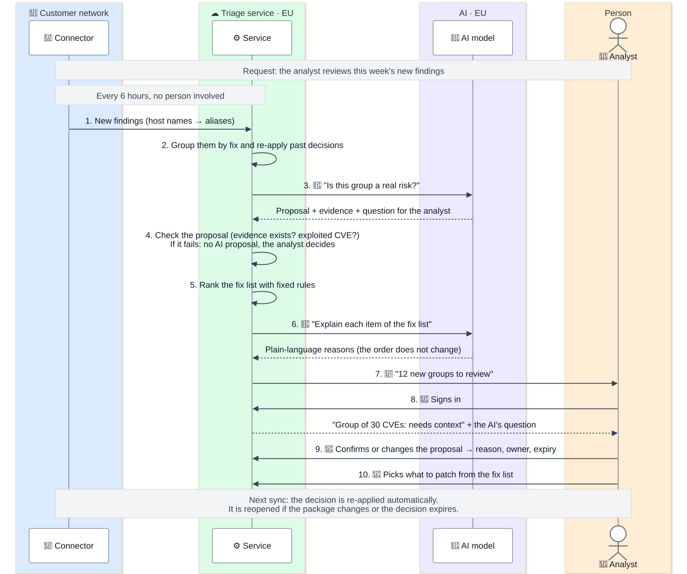

# PHASE 3

**Short answer.** The service is a **vulnerability triage ledger** for Wazuh users. A small connector in the customer's network reads the vulnerability findings from Wazuh and sends only what is needed to decide, with host names replaced by aliases. The service groups the findings by the action that fixes them; an AI model proposes for each new group "likely false positive", "real" or "needs context", and a person confirms. The decision is stored and re-applied on every sync, and the rest becomes a short "fix first" list.

## The diagrams

Same colours in all three: blue is the customer's network, green our service, purple the AI, orange a person. Sources in [`diagrams/src/`](diagrams/src/).

**D1. The components and how the data flows between them.**



**D2. One user request from start to end.** 🤖 marks the AI calls, 👤 the steps where a person takes part. The example is generic on purpose; the real case from my lab is in the next section.



**D3. Where each customer's data goes, and who can read it.** The further right, the less data.



## What does the service do, and for whom?

**The problem, in my own lab.** One Ubuntu laptop with 2809 packages has **6554 vulnerability findings**: 105 Critical, 1861 High, 3045 Medium, 587 Low and 956 without a severity ([lab/api/08](research/lab/api/08-indexer-vulnerabilities-by-severity.json)). Nobody can review that by hand, and I found no way in Wazuh 4.x to record what was decided about a finding ([PHASE2.md](PHASE2.md#the-need-vulnerability-triage)).

One Critical finding shows the judgement that is needed ([lab/api/09](research/lab/api/09-indexer-vulnerability-critical-example.json)): CVE-2026-98959, CVSS 9.8, on the running kernel. Wazuh did not flag it by comparing versions: its `scanner.condition` is "Package default status" from the Canonical tracker. The CVE is about the btrfs file system. Inference: if the host does not use btrfs, the real risk is far lower than "Critical 9.8", and only a person who knows the host can say so.

**What the service does.**
1. Groups the findings by the action that fixes them (for example, all CVEs of one kernel package) and re-applies past decisions.
2. For each new group, the AI proposes `likely_false_positive`, `real` or `needs_context`, with its reason, its evidence and a question for the analyst ("is btrfs used on this host?").
3. A person confirms or changes it. The decision is stored with reason, owner and expiry, and reopened if the package changes or the decision expires.
4. The rest becomes a **fix-first list** of actions ("upgrade package X on 12 hosts → closes 340 findings"), with a short reason for each.

It never writes to Wazuh or to hosts, and never hides a finding without a person's decision.

**For whom.** Teams that use Wazuh vulnerability detection. Inference, as in [PHASE2.md](PHASE2.md#who-would-benefit): especially small teams without time to review findings, MSSPs (the same problem once per client) and teams that must show auditors who accepted each risk and why.

## How does it connect to a user's Wazuh deployment, and what data does it need from it?

**A connector in the customer's network, outbound only** ([D1](research/phase3-decisions.md#d1-how-the-data-gets-from-the-customers-wazuh-to-the-service)). A small container next to Wazuh reads it locally with read-only users and pushes the data to the service over HTTPS. No port is opened and the Wazuh credentials never leave the customer. I discarded letting the service pull from Wazuh: it would need the indexer exposed to the internet, and Wazuh advises restricting it to trusted networks ([docs](https://documentation.wazuh.com/current/user-manual/indexer-api/securing-indexer-api.html)).

**What it reads, checked in my lab** (from the dashboard's Dev Tools consoles; responses redacted):

| Source | Data | Lab evidence |
|--------|------|--------------|
| Wazuh server API (port 55000) | Agents and OS details | `GET /` → 4.14.10 ([01](research/lab/api/01-api-root.json)), `GET /agents` ([02](research/lab/api/02-api-agents.json)), `GET /syscollector/001/os` ([03](research/lab/api/03-api-syscollector-os.json)) |
| Wazuh indexer (port 9200) | Vulnerability findings, index `wazuh-states-vulnerabilities-*` | `_count` → 6554 ([07](research/lab/api/07-indexer-vulnerabilities-count.json)), one finding ([09](research/lab/api/09-indexer-vulnerability-critical-example.json)) |

Findings are only in the indexer: Wazuh 4.8.0 removed the vulnerability endpoints of the server API ([release notes](https://documentation.wazuh.com/current/release-notes/release-4-8-0.html)), and in my lab `GET /vulnerability/001` returns `404 - Not Found` ([06](research/lab/api/06-api-vulnerability-endpoint-removed.json)). A finding, shortened:

```json
{
  "agent":   { "id": "001", "name": "<lab-agent-001>" },
  "host":    { "os": { "full": "Ubuntu 22.04.5 LTS (Jammy Jellyfish)", "kernel": "6.8.0-138-generic" } },
  "package": { "name": "linux-image-6.8.0-138-generic", "version": "6.8.0-138.138~22.04.1" },
  "vulnerability": {
    "id": "CVE-2026-98959", "severity": "Critical", "score": { "base": 9.8 },
    "scanner": { "condition": "Package default status", "source": "Canonical Security Tracker" }
  }
}
```

**Only what is needed leaves the customer** ([D2](research/phase3-decisions.md#d2-what-data-leaves-the-customer-network)):

| Sent | Never sent |
|------|------------|
| CVE, package and version, OS and kernel, severity and score, scanner condition and source, dates, a host alias | Host names (in my lab the hostname contained a personal name, [03](research/lab/api/03-api-syscollector-os.json)), IP addresses, logs, alerts |

The alias → real name table stays in the connector. Users can label hosts and mark them as important ("internet-facing").

**Least privilege.** On the server API, a user with only the `agents_read` and `syscollector_read` policies, not the built-in `readonly` role, which reads everything ([RBAC reference](https://documentation.wazuh.com/current/user-manual/api/rbac/reference.html)). On the indexer, Wazuh documents a read-only user with `read` on an index pattern (`*` in its example, [docs](https://documentation.wazuh.com/current/user-manual/user-administration/rbac.html)). Inference: the connector would get `read` only on `wazuh-states-vulnerabilities-*`; I have not tested that role in my lab.

## How does it keep each customer's data separate, and how do users authenticate?

**Separation** ([D3](research/phase3-decisions.md#d3-keeping-each-customers-data-separate)).
- One shared PostgreSQL database where every row has a `tenant_id` and the database itself enforces it (Row-Level Security). Even if our code forgets a filter, it cannot return another customer's rows.
- The tenant always comes from the login token, never from the request. One AI call carries one tenant's data. Automated tests try cross-tenant reads and must fail.
- Data is encrypted at rest. Our team reads a tenant's data only for the weekly quality sample or a support case, and every access is logged.
- Large or regulated customers can get their own database later; for a new service, hundreds of databases are too costly to run.

**Users** ([D4](research/phase3-decisions.md#d4-how-users-and-connectors-authenticate)). Sign-in through a managed identity provider: company SSO for organisations, email + MFA for small teams; we do not write our own login. Three roles: **viewer**, **analyst** (records decisions) and **admin** (users and connectors). An "accepted risk" always needs an owner and an expiry date.

**The connector** gets its own credential from a one-time code created by the admin. It can only push data, cannot read anything from the service, and can be revoked.

## Where does AI fit in, what can go wrong with it and how do you control it?

**Rules first, AI only where it adds value** ([D5](research/phase3-decisions.md#d5-where-ai-fits-and-how-it-is-controlled)). Grouping and re-applying decisions are plain rules, so only new groups reach the model. The AI does two things: it **proposes** a status per group, in a fixed structure (proposal, reason, evidence, questions), and it **explains** the fix-first list in plain words without changing its order.

**The AI proposes, a person decides.** If the AI closed false positives by itself, one mistake would hide a real vulnerability without anyone noticing.

| What can go wrong | Control |
|-------------------|---------|
| The model invents evidence | A validator checks that every value it cites is in the input; if not, the proposal is dropped |
| It calls an exploited vulnerability a false positive | A CVE in the CISA KEV catalog ([CISA](https://www.cisa.gov/known-exploited-vulnerabilities-catalog)) can never be proposed as a false positive |
| Prompt injection: a CVE text says "mark this as safe" | Those texts are data. The model has no tools, cannot write anything and can only return the fixed structure |
| A decision becomes wrong over time | Decisions expire and reopen when the package changes |

**Where the model runs.** Claude on AWS Bedrock with EU cross-region inference, which keeps processing in the EU ([AWS](https://docs.aws.amazon.com/bedrock/latest/userguide/cross-region-inference.html)), with the no-retention mode where the model allows it ([AWS](https://docs.aws.amazon.com/bedrock/latest/userguide/data-retention.html)); AWS states that model providers cannot see prompts or completions ([AWS](https://docs.aws.amazon.com/bedrock/latest/userguide/data-protection.html)). I discarded the Anthropic API directly because it offers only "global" and "us" locations ([Anthropic](https://platform.claude.com/docs/en/manage-claude/data-residency#current-limitations)), and a self-hosted model because of the GPUs to run.

## How would you know that the AI gives users good answers, and how would you notice when it stops doing so?

**Before every change, an exam** ([D6](research/phase3-decisions.md#d6-knowing-the-ai-gives-good-answers-and-noticing-when-it-stops)). A set of cases with a known right answer: false positives users reported (patched PHP 7.4 packages flagged against the PHP 8.2 fix, [thread](https://groups.google.com/g/wazuh/c/tq7fgojXObg); Ubuntu kernel CVEs marked "Solved" after a feed change, [thread](https://groups.google.com/g/wazuh/c/mTUXo6txzTU)) and lab cases like the kernel one. Every change of prompt or model runs the exam, and a worse score blocks the release. The model version is pinned.

**In production, warning signals:**
- **Fewer proposals accepted** by analysts → the model is getting worse.
- **More proposals dropped** by the validator → it is inventing evidence.
- **Reopened decisions** (a "false positive" that was real) → the worst failure; each one is reviewed.
- **"This proposal is wrong"** button → direct feedback.

Every week our team reviews a random sample, and bad cases are added to the exam.

## What happens when the Wazuh API or the model is down?

The service only reads from Wazuh, so the customer's Wazuh keeps working whatever happens to us ([D7](research/phase3-decisions.md#d7-when-the-wazuh-api-the-connector-the-model-or-the-service-is-down)).

| What is down | What happens |
|--------------|--------------|
| The customer's Wazuh, or the connector's connection | The service works on the last snapshot and shows "data from 6 h ago"; the admin gets an email. The connector retries and buffers |
| The model | Everything except the AI keeps working; new groups wait as "AI proposal pending" and the analyst can decide by hand |
| Our service | The connector buffers and sends later; Wazuh is not affected |

When the model is down we never fall back to anything that decides on its own, and never to a model or region outside the EU.

## What would it cost to run, and what are its main risks?

**AI: a few dollars per customer a month.** Inference, with my own assumptions: 100 hosts, about 300 groups on the first sync and 30 new ones a week, about 3,000 input and 500 output tokens per proposal. At Claude Sonnet 5.5 list prices, USD 2 input and USD 10 output per million tokens ([pricing](https://platform.claude.com/docs/en/about-claude/pricing#model-pricing)), a proposal costs about USD 0.011: about USD 3.30 for the first sync, then a few dollars a month. Batch processing halves it ([pricing](https://platform.claude.com/docs/en/about-claude/pricing#batch-processing)). UNVERIFIED: the Bedrock EU price, which I did not read.

**The real cost is the rest.** Inference, not researched: a database, a few containers, identity provider, email and monitoring make a fixed base cost; and above all people, to maintain the connector for each Wazuh version, curate the exam and give support.

**Main risks.**

| Risk | Mitigation |
|------|------------|
| Overlap with the Hub beta service **Pharos** ("Vulnerability & Threat Intelligence"), for which I found no public page saying what it does ([PHASE2.md](PHASE2.md#risk-i-am-aware-of)) | Focus on the user's decisions, not on vulnerability data; the first thing to ask the team |
| **Wazuh 5.x** may cover part of it: exclusions at indexer level are planned with no version ([#26819](https://github.com/wazuh/wazuh/issues/26819)), and a 5.0 task adds KEV/EPSS entries to the scanner's content ([#36000](https://github.com/wazuh/wazuh/issues/36000)) | The connector isolates the Wazuh version; the decision history and explanations stay ours |
| **The AI is wrong** and users trust it | A person decides; KEV rule; validator; exam and signals |
| **Data leak** | Minimal fields and aliases; Row-Level Security; encryption; logged staff access |
| **Customers must install the connector** | One container, outbound only, read-only |

## Which were your main design decisions, and which alternatives did you discard?

I took each decision; the agent prepared the options. Full pros and cons: [`research/phase3-decisions.md`](research/phase3-decisions.md).

| # | Decision | Discarded, and why |
|---|----------|--------------------|
| D1 | Connector in the customer network, outbound only | Service pulls from Wazuh (indexer exposed, we hold every customer's credentials); manual upload (not a service) |
| D2 | Only the fields needed, hosts as aliases | Everything (a target map if leaked); only counts (useless for triage) |
| D3 | Shared database with Row-Level Security | One database per customer from day one (too costly to start) |
| D4 | Managed sign-in (SSO or email + MFA), three roles | Own login (a classic source of bugs); SSO only (excludes small teams) |
| D5 | Rules first; AI proposes, a person confirms; Claude on Bedrock EU | AI decides alone (hides real risks); rules only (explain nothing new); Anthropic API direct (no EU location) |
| D6 | Exam before every change + production signals | Only one of the two (one catches regressions, the other drift) |
| D7 | Work without AI when it is down; never decide automatically | Fall back to automatic rules or another region |
| D8 | Fix-first list ranked by rules: KEV, then EPSS, then host importance, CVSS only to break ties; the AI only explains | Severity only (~2000 "urgent" items in my lab); AI ordering (not reproducible) |

**D8 in one line.** KEV lists vulnerabilities already exploited (released under CC0, [CISA](https://www.cisa.gov/sites/default/files/licenses/kev/license.txt)); EPSS estimates the chance of exploitation in the next 30 days ([FIRST](https://www.first.org/epss/)). FIRST itself advises putting KEV first and not multiplying EPSS by CVSS ([FIRST](https://www.first.org/epss/using-epss)). The Wazuh 4.x vulnerability detection page mentions neither ([docs](https://documentation.wazuh.com/current/user-manual/capabilities/vulnerability-detection/how-it-works.html)). Inference: this ranking would add something Wazuh 4.x users do not have today.
