# PHASE 4

**Short answer.** I worked in a loop: plan → saved prompt → research → independent verification → my review → writing → log of every correction → commit after my OK. The rules live in files the agents read, and the important limits are enforced by tools. I would build the service the same way: agents write code, tests and docs in their own branch; people approve what to build and what to merge; and what must never happen (cross-customer reads, an AI that decides alone, an agent in production) is blocked by layers outside the prompt.

## The diagrams

Colours: orange is a person, purple an AI agent, green files and checks in the repository, blue my machine and environments, red what is blocked. Sources in [`diagrams/src/`](diagrams/src/).

**D4. How I worked during this task, and the development environment I am comfortable with.**

**D5. The agent setup I would use to build the service, and how a task moves from an idea to production.** The same setup as real files: [`phase4/agent-setup/`](phase4/agent-setup/).

## Everything I used to direct my agents

| What | Where |
|------|-------|
| Rules every agent reads, and which guardrails are enforced or only instructed | [`CLAUDE.md`](CLAUDE.md) |
| The two subagents and their allowed tools | [`.claude/agents/`](.claude/agents/) |
| Permission rules and the hook that blocks forbidden actions | [`.claude/settings.json`](.claude/settings.json), [`.claude/hooks/guard.py`](.claude/hooks/guard.py) |
| Git hook that protects Phase 1 and the brief | [`.githooks/pre-commit`](.githooks/pre-commit) |
| Plans and every prompt I gave a subagent | [`workflow/`](workflow/) |
| Notes, verification reports, decisions | [`research/`](research/) ([index](research/README.md)) |
| Every correction I made to the AI | [`research/ai-log.md`](research/ai-log.md) |

## How did you use AI in phases 2 and 3, where did it help you and where did you have to correct it?

**How.** Claude Code in VS Code as the main agent, plus two subagents: a `researcher` that searches the web and can write only in `research/sources/`, and a `verifier` that checks every claim of a note against its URL and cannot search or edit notes. Every step followed the loop of D4.

**Where it helped.**
- **Breadth.** Reading dozens of GitHub issues, forum threads and docs pages for the Phase 2 catalogue of needs would have taken me days.
- **Checking.** The verifier caught statements wider than their source that I would have missed: 9 in the PHASE2 draft, 12 in the PHASE3 draft.
- **Options for decisions.** In Phase 3 the agent wrote options with pros and cons for most decisions ([`phase3-decisions.md`](research/phase3-decisions.md)) and I chose.
- **Drafting.** Diagrams, tables and redaction of lab outputs.

**Where I had to correct it** ([`research/ai-log.md`](research/ai-log.md)):

| Kind of mistake | Rows | Example |
|-----------------|------|---------|
| Saying more than the source says | 3, 4, 5, 8, 9, 11, 13 | "Several users" for one; an open issue called "closed by maintainers" |
| Inventing a role for a person | 2 | Forum repliers called "Wazuh staff" with nothing on the page saying so |
| Assuming, or ignoring how I want to work | 1, 10 | Described my lab as virtual machines without reading PHASE1.md; started my lab containers on its own |
| Wasting resources | 7 | 12 verifiers in parallel, one per note, used up my token budget |
| Output not fit for its purpose | 12 | Diagrams too dense to present |
| Incomplete change to the setup | 6 | Changed the researcher's rules without updating the verifier's |

**What I learned.** The most common mistake (7 of 13 rows) was a statement wider than its source, in the researcher's notes and in the main session's drafts alike. A rule in the prompt did not stop it; a second agent with one narrow job did. And what must never happen cannot rest on instructions: Claude Code itself treats CLAUDE.md as "context, not enforced configuration" and points to hooks for blocking ([docs](https://code.claude.com/docs/en/memory)). So Phase 1, pushes and each subagent's write folder are guarded by a hook that knows which agent is calling (`agent_type`, [docs](https://code.claude.com/docs/en/hooks#common-input-fields)), and each subagent has a `tools` allowlist ([docs](https://code.claude.com/docs/en/sub-agents)).

## How would you split the work of building the service between you and your agents?

The agents do most of the typing; people do the deciding (D5):

| Me (and the team) | Agents |
|-------------------|--------|
| What to build: talking to users, priorities, approving each spec | Draft issues and specs from notes and user feedback |
| Design decisions and the rules that never break | Draft options and ADRs, as in Phase 3 |
| Review, merge, release; decisions during an incident | Implement in their own branch (tests first, code, docs); first review (`reviewer`); keep docs in sync (`docs-keeper`); read logs and draft post-mortems |
| The right answers of the AI exam | Run the exam and compare with the last run (`eval-runner`) |

**How I would run them.** One task, one branch, one git worktree per agent, so two agents never touch the same files (Claude Code supports `isolation: worktree` for subagents, [docs](https://code.claude.com/docs/en/worktrees#isolate-subagents-with-worktrees)). Two or three agents at a time, which is what I can review well (ai-log row 7). Small tasks, so I review a short pull request instead of a big surprise.

## How would you check that what your agents produce is correct and safe before it reaches users?

In layers, each catching what the previous one misses ([`pipeline.md`](phase4/agent-setup/pipeline.md)):

1. **The spec**, approved by a person, with acceptance tests and the "never break" rules it touches.
2. **Tests first**: tests that fail, then code that makes them pass; a test is never weakened to get green.
3. **CI, required to merge**: lint and unit tests; **tenant isolation tests** that try to read another customer's data and must fail; the **AI exam** for any change to prompts or the model; dependency and secret scans; a docs check.
4. **A second agent reviews**, read-only, against the spec and the never-break rules ([`reviewer.md`](phase4/agent-setup/.claude/agents/reviewer.md)). Same idea as my verifier.
5. **A person reviews and merges.** Migrations, authentication, the AI proposer and prompts need a second person through code owners.
6. **Staging with lab data, then a few customers**, with automatic rollback on errors; a person releases to everyone.
7. **Production signals** from Phase 3: errors, uptime, AI acceptance rate, validator drops, reopened decisions.

**The agent itself is limited too.** Outside the agent: permission rules, hooks and the sandbox on the development machine ([`settings.json`](phase4/agent-setup/.claude/settings.json)); branch protection and required checks on GitHub; and no production credentials or customer data where agents run, a rule for the machines that no settings file can guarantee. No layer is enough alone: a Bash deny rule "isn't a security boundary around the program" ([docs](https://code.claude.com/docs/en/permissions#bash-rule-limits)), and the sandbox limits shell commands but not file tools ([docs](https://code.claude.com/docs/en/sandboxing)).

## Which part of the work would you not leave to an agent, and why?

1. **What to build and the main design trade-offs.** Someone must own the decision and answer for it to users and the team. Agents prepare the options, as in Phase 3.
2. **The security boundary**: tenant isolation, authentication, what data leaves the customer, secrets, and the guardrails themselves. A mistake here leaks one customer's data to another, and an agent must never edit its own permissions, CI or code owners.
3. **Merging, releasing and acting in production**, including incident decisions (rollback, telling customers).
4. **The right answers of the AI exam.** Otherwise the AI grades itself.
5. **Talking to users.** Reading feedback myself is how I learn what matters; a summary loses the tone and the odd case.

## If users gave you feedback on the service, how would you handle it?

1. **One place:** the "this proposal is wrong" button (Phase 3), an in-app form, support email and the Wazuh community channels, all into one tracker.
2. **Weekly sort:** an agent groups similar items and links them to existing issues; I also read the raw items.
3. **Decide:** I choose what becomes work, by how many users it affects and how it fits the product. Chosen items go issue → spec → the normal pipeline.
4. **Bad AI answers become exam cases**, labelled by a person, so the same mistake blocks future releases.
5. **Close the loop:** the user hears back when it is fixed, and the changelog says so.

Agents that sort feedback see only the text the user sent.

## If users report that the service is down, how would you be ready to respond?

**Before.**
- **Know before the users:** an outside check that signs in and loads the fix-first list every minute, connector heartbeats, and error and latency alarms that page the person on call.
- **A status page** and a message template for customers.
- **A runbook per failure** in the Phase 3 table (customer's Wazuh or connector, model, our service), kept with the code.
- **Design that limits the damage:** the connector buffers and retries, the customer's Wazuh never depends on us, and without the model the rest still works.

**During.** Confirm and post on the status page; look first at what changed, starting with the last deploy; mitigate (rollback, switch off the failing feature), then fix. An agent with read-only access to logs and metrics helps find the cause and keeps the timeline; people decide and act.

**After.** A blameless post-mortem; each lesson becomes an alarm, a test or a runbook change.

## If it grew into a full service with more features and more customers, how would you keep the design integrated?

- **One source of truth:** design docs and ADRs in the repo. Agents read them before changing a component; a new decision is a new ADR that a person accepts.
- **Never-break rules tested, not only written:** a CI test that every tenant table has Row-Level Security, isolation tests for every new endpoint, a check that no code path changes a status from a model output.
- **Shared building blocks:** one way to get the tenant from the token, one model client (EU only, model pinned), one validator, reused by every feature.
- **New features through the same door:** the Phase 2 ideas left for later (what changed between scans, a compliance export) each start as a spec naming the components and rules it touches.
- **Clear boundaries:** the connector's API is versioned and tested against each supported Wazuh version, so Wazuh 5.x changes stay inside the connector.
- **A person looks at the whole.** Inference: agents work task by task and do not see slow drift; a regular architecture review catches it.

## How would you document it, and how would you make sure every change is backed by up-to-date documentation?

**What docs.** A README per component, design docs and ADRs, an API reference generated from the code, runbooks, user docs, a changelog, and `CLAUDE.md`, which documents the project for agents and people alike.

**Every change backed by docs.**
- **Same pull request:** docs change with the code; it is in the definition of done ([`CLAUDE.example.md`](phase4/agent-setup/CLAUDE.example.md)).
- **CI enforces it:** a change in the services without a change in `docs/` fails unless a person marks it "no docs needed"; the API reference is regenerated and must match; links are checked.
- **An agent keeps docs true** (`docs-keeper`): it drafts missing updates and flags docs the code no longer matches; a person reviews them like code.
- **Docs describe today.** Plans go in issues; each doc has an owner.
